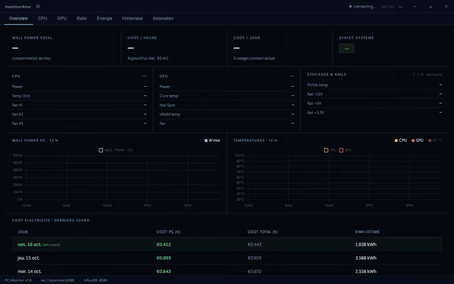

# monitor4me

**English** | [Français](README.fr.md)


Hardware monitoring dashboard for Windows PCs: temperatures, power draw, electricity cost and history.



> The demo uses **synthetic data** (mocked collector and InfluxDB), not real measurements. Full video: [docs/media/demo.mp4](docs/media/demo.mp4).

## Features

- **Live sensors**: CPU/GPU temperature, power and clocks, NVMe, PSU rails (+12V / +5V / +3.3V), fan RPM.
- **Electricity cost**: live cost per hour, today's total, 31-day history with daily detail, monthly projection.
- **Peripherals**: monitors are auto-detected via WMI, with configurable per-device consumption.
- **Anomaly detection**: z-score alerts for thermal throttling, GPU clock drops and rail instability.
- **History charts**: hourly kWh over 24h, 7-day bars, full 31-day table.

## Architecture

```
LibreHardwareMonitor (:8085, data.json)
        |  poll every 2 s
        v
   collector (Node.js)  --writes-->  InfluxDB 2 (:8086)
        |                                   ^
        | WebSocket (:8088, live data)      | Flux queries (history)
        v                                   |
              Tauri 2 dashboard (TypeScript, Vite, Chart.js)
```

| Part | Technology |
|---|---|
| Desktop app | Tauri 2, TypeScript, Vite, Chart.js |
| Collector | Node.js, TypeScript |
| Sensors | [LibreHardwareMonitor](https://github.com/LibreHardwareMonitor/LibreHardwareMonitor) web server |
| Storage | InfluxDB 2, Flux |
| Monitor detection | WMI via PowerShell |

A Grafana dashboard is also provided in [`grafana/dashboards/pc-monitor.json`](grafana/dashboards/pc-monitor.json).

## Requirements

- Windows 10 (build 1903+) or Windows 11, x64.
- Internet access during setup (dependencies are downloaded).
- Installed by the setup: .NET Desktop Runtime 10 (required by LibreHardwareMonitor), InfluxDB 2.7 (port 8086), LibreHardwareMonitor (port 8085), Node.js LTS (collector runtime).
- Administrator rights (UAC prompt) to install services and scheduled tasks.

## Installation

### Option 1: installer from the release (recommended)

1. Download `monitor4me_x64-setup.exe` from the [latest release](https://github.com/MehdiZen/monitor4me/releases/latest).
2. Run it. Windows may warn about an unknown publisher: *More info > Run anyway*.
3. On first launch, the **Setup Wizard** asks for your electricity rate (EUR/kWh); accept the UAC prompt.
4. The wizard installs and configures the dependencies listed above and the collector, then starts the services (also started at each Windows boot). No reboot required.

To repair or reinstall, open the settings (gear icon) and click **Repair**.

If no data shows up ("Reconnecting" status), enable the LibreHardwareMonitor web server manually: **Options > Remote Web Server > Run** (port 8085).

### Option 2: scripts from this repository

- `monitor4me-install.bat` (or `install.ps1`): Windows Forms installer, pick the components and click *Install* (it elevates itself).
- `scripts/setup-from-source.ps1`: interactive step-by-step setup from a source checkout (asks confirmation before each step).
- `uninstall.ps1`: removes monitor4me and, optionally, its dependencies.

## Configuration

Environment variables (documented in [`.env.example`](.env.example), fake values only):

| Variable | Used by | Description |
|---|---|---|
| `INFLUX_TOKEN` | collector, desktop app | InfluxDB API token. Set by the installer as a Windows user variable. There is no built-in default: when unset, requests to InfluxDB are rejected. |

> **Security note.** The installer creates the local InfluxDB admin account with the default password `monitor4me-local` (the field can be changed in `install.ps1`). By default InfluxDB listens on all network interfaces (port 8086), so anyone on your network could sign in with that password. Change it after installing (InfluxDB UI at `http://localhost:8086`), or restrict InfluxDB to `127.0.0.1` / block the port in your firewall. The database only holds hardware metrics.

The `.env` file is **not** loaded automatically: set the variable in your environment. Other settings (electricity rate, CPU/GPU TDP, temperature thresholds, peripherals) are edited from the dashboard settings; the collector persists them in `collector/user-config.json` (git-ignored). Fixed defaults (ports, poll interval, PSU efficiency) live in [`collector/src/config.ts`](collector/src/config.ts).

## Development

Prerequisites: Node.js, and the [Tauri 2 prerequisites](https://tauri.app/start/prerequisites/) (Rust toolchain, WebView2, MSVC build tools).

Desktop app (`app/`):

```bash
cd app
npm install
npm run dev            # Vite dev server on :5173 (front only)
npm run tauri dev      # full Tauri app in dev mode
npm run build          # tsc + vite build
npm run tauri:release  # tauri build (installer)
```

Collector (`collector/`):

```bash
cd collector
npm install
npm run dev            # ts-node src/index.ts
npm run build          # tsc -> dist/
npm start              # node dist/index.js
```

The project has no automated test suite or linter configured. Type checking: `npx tsc --noEmit` in `app/` and in `collector/`.

## Repository layout

```
monitor4me/
├── app/                  Tauri desktop app
│   ├── src/              UI (main.ts, charts.ts, influx.ts, ws-client.ts, store.ts, styles.css)
│   └── src-tauri/        Rust layer (window, tray, updater, setup commands)
├── collector/            Node.js collector (LHM -> InfluxDB + WebSocket)
│   └── src/              index, lhm, metrics, anomaly, monitors, notify, influx, ws, config
├── grafana/dashboards/   Optional Grafana dashboard
├── scripts/              Setup, packaging and release scripts (PowerShell)
├── docs/media/           Demo video and GIF
├── install.ps1, monitor4me-install.bat, uninstall.ps1
└── LICENSE
```

## Hardware notes

- **RX 9070 XT**: limited LHM GPU support; the collector sets `gpu_power_estimated=true` when estimating.
- **RAM**: no sensor available on AM5, fixed 10 W estimate.
- **CPU RAPL**: underestimates by ~7%, corrected by `CPU_RAPL_CORRECTION = 1.07`.

## License

Copyright (c) 2026 Mehdi Zenati. monitor4me is **source-available** under a dual license: free for personal non-commercial use, paid license for commercial/professional use. See [LICENSE](LICENSE) for the exact terms. Third-party components (LibreHardwareMonitor, InfluxDB) keep their own licenses.
